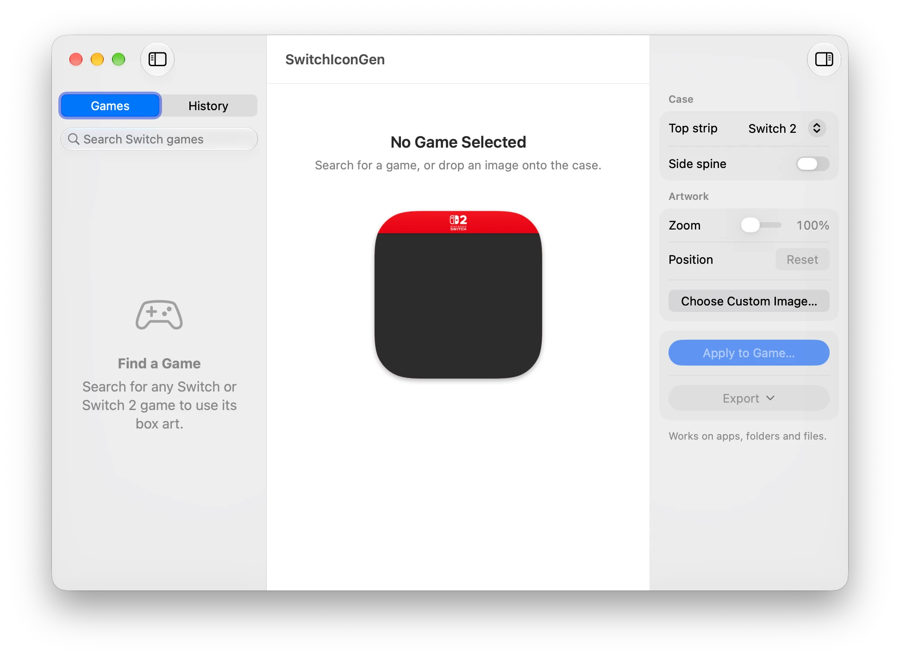

# SwitchIconGen

Turn Switch and Switch 2 box art into macOS game icons.



## Download

[SwitchIconGen.zip](https://github.com/RonanKilbride/SwitchIconGen/releases/latest/download/SwitchIconGen.zip) · macOS 14 or later

The app isn't notarized. On first launch, open **System Settings → Privacy & Security** and click **Open Anyway**.

## Build

```bash
./build.sh
```

By Ronan Kilbride.
